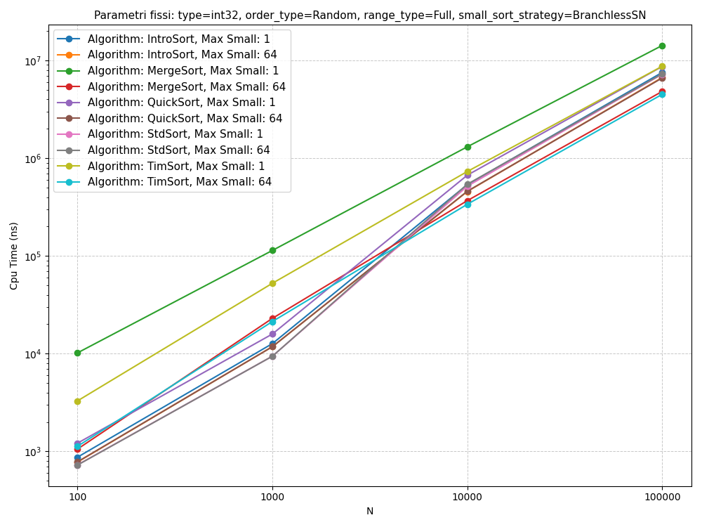

# Branchless Fixed Sorts as Base Cases of Divide-and-Conquer Sorting Algorithms

BSc thesis in Computer Science, University of Milan, July 2025. Supervisor: Prof. Giovanni Pighizzini. Code comments are in Italian.

DeepMind's AlphaDev ("Faster sorting algorithms discovered using deep reinforcement learning", *Nature*, 2023) found faster assembly routines for sorting 3 to 8 elements. This thesis asks whether such fixed-size sorts, and branchless sorting networks, speed up general-purpose divide-and-conquer sorts when used as their base cases, on both x86-64 and ARM64.

## What's in the repo

- **AlphaDev fixed sorts** for 3 to 8 `int32` elements: the original x86-64 inline assembly, and a port to ARM64 written for this thesis.
- **Branchless sorting networks** in C++ for every size from 3 to 64, using the best-known networks, written so that each compare-and-swap compiles without branches. `src/generate_sn.cpp` generates them from a network's list of comparators.
- **Quicksort** (Hoare partition), **Mergesort**, **Introsort** and **Timsort**, templated on the element type, with a `maxSmall` threshold: subarrays up to that size go to a pluggable base case (AlphaDev, sorting network, insertion, selection or bubble sort).
- **Tests:** 231 Google Test cases for the fixed sorts and the full algorithms, on `int32`, `int64` and `float`.
- **Benchmarks** with Google Benchmark across element types, sizes from 3 to 100,000, seven input orders (random, ascending, descending, pipe organ, constant, mostly sorted, natural runs) and four value ranges.

## Findings

Benchmarked on an Apple M1 (ARM64, macOS 15) and a 12th-gen Intel Core i7 (x86-64, Windows 11), both with Clang 20.1.7, libc++ and `-O3 -march=native`.

- **AlphaDev vs sorting networks.** AlphaDev's routines are faster in isolation, but as base cases they perform about the same as the networks: inline assembly is opaque to the compiler, while the C++ networks are optimised together with the surrounding code. The networks are also portable and work for any element type, so the later experiments use them.
- **Sorting networks vs insertion sort.** As base cases on random data, the networks beat insertion sort at every threshold tested (8 to 64), and higher thresholds ran faster.
- **Timsort.** With sorting networks and a threshold of 64, Timsort was almost always the fastest algorithm on random arrays of 10,000 elements or more, and stayed fast on presorted data.
- **The other algorithms.** With the networks, Mergesort, Quicksort and Introsort were consistently faster than their original versions. At 1,000 elements or fewer, libc++'s `std::sort` was often the fastest overall.



*Apple M1, `int32`, random data. "Max Small: 1" disables the base cases (the textbook version of each algorithm); "Max Small: 64" uses sorting networks up to 64 elements. `std::sort` ignores the threshold.*

### All plots

CPU time for every experiment, in `plots/` (Apple M1) and `plots_win/` (Intel). Plot titles are partly in Italian ("Parametri fissi" means fixed parameters).

| Plots | Experiment |
|---|---|
| 1 | Insertion, selection and bubble sort on 3 to 128 elements |
| 2 | AlphaDev vs sorting networks as base cases (10,000 elements, thresholds 3 to 8) |
| 3–5 | Sorting networks vs insertion sort as base cases (thresholds 8 to 64; `int32`, `int64`, `float`) |
| 6–7 | Timsort variants on random data and on natural runs |
| 8–10 | All algorithms on random data (`int32`, `int64`, `float`) |
| 11–16 | All algorithms on ascending, descending, pipe-organ, constant, mostly sorted and natural-runs data |

## Build and run

Needs CMake 3.16+, Ninja and Clang with libc++ (tested with Clang 20.1.7). CMake fetches Google Test and Google Benchmark.

```bash
./configure.sh        # macOS
ninja -C build
./build/run_tests
```

On Windows, use MSYS2 with MinGW-w64 and `configure_win.sh`, after setting the compiler paths in it. CMake picks the AlphaDev assembly for the host architecture, and `-march=native` tunes the build to the machine it runs on.

The benchmark takes comma-separated lists of element types, sizes, base-case sorts, algorithms, thresholds, value ranges and input orders:

```bash
mkdir -p outputs
./build/benchmark_app --benchmark_out=outputs/results.json \
  int32 10000 BranchlessSN TimSort,QuickSort 1,64 Full Random
```

`run.sh` runs the thesis benchmark suites and `generate_graphs.sh` plots them; it expects a Python virtual environment named `venv_grafici` with pandas and matplotlib.
